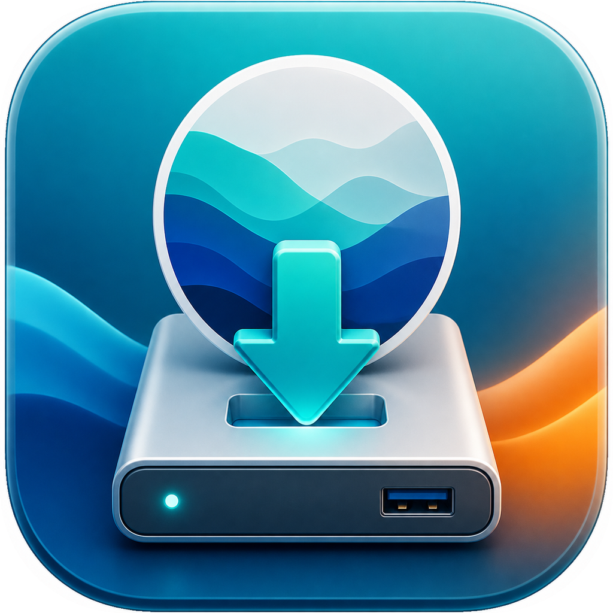

<p align="center">
  
</p>
<h1 align="center">macOS Downloader</h1>
<p align="center"><strong>Official macOS installers, with download progress and a bootable USB writer.</strong><br>A native Apple Silicon app for finding, downloading, and preparing macOS installers.</p>
<p align="center">
  
  
  <a href="https://github.com/ProvenceJake/macos-downloader/releases/tag/v1.0.0-preview.1"></a>
</p>
<p align="center"><strong>English</strong> · <a href="README.zh-CN.md">简体中文</a></p>
<p align="center">
  <a href="https://github.com/ProvenceJake/macos-downloader/releases/download/v1.0.0-preview.1/MacOS-Downloader-v1.0.0-preview.1-arm64.dmg"><strong>Download for Apple Silicon</strong></a> ·
  <a href="https://github.com/ProvenceJake/macos-downloader/releases/tag/v1.0.0-preview.1">Release notes</a> ·
  <a href="#build-from-source">Build from source</a> ·
  <a href="#before-writing-a-usb-drive">USB safety</a> ·
  <a href="https://github.com/ProvenceJake/macos-downloader/issues">Report an issue</a>
</p>

---

macOS Downloader reads Apple's software update catalog when it starts and when you refresh it. For the modern macOS families configured in the app, it resolves the available full `InstallAssistant.pkg` again when you begin a download. The app downloads in the foreground and shows bytes, speed, remaining time, and progress. It also offers direct Apple DMG links for selected older releases.

> [!IMPORTANT]
> This is an independent project, not an Apple product. The preview DMG and locally built app are ad-hoc signed and **not notarized**. Creating a bootable USB drive **erases the selected external disk**. Check the target carefully before confirming.

## Download

Download the [Apple Silicon DMG](https://github.com/ProvenceJake/macos-downloader/releases/download/v1.0.0-preview.1/MacOS-Downloader-v1.0.0-preview.1-arm64.dmg) and check its [SHA-256 checksum](https://github.com/ProvenceJake/macos-downloader/releases/download/v1.0.0-preview.1/SHA256SUMS.txt). Open the DMG and drag **MacOS下载器.app** to **Applications**. The image also contains both README files. Because the app is not notarized, macOS may warn before opening it; do not disable system-wide security protections to run it. You can build from source instead.

## What it does

| Installer catalog | Visual download | Bootable USB |
| --- | --- | --- |
| Lists the configured modern macOS families, resolves available full installers, and links to selected legacy DMGs. | Downloads `InstallAssistant.pkg` in the foreground with live progress and speed, then installs the downloaded package into `/Applications`. | Finds local installer apps and mounted external drives, then runs Apple's `createinstallmedia` and mirrors its output in the app. |

Modern installer availability depends on Apple's catalog and your Mac. A catalog entry is **not** a guarantee that the chosen macOS can be installed on a particular Mac. Check [Apple's macOS compatibility guidance](https://support.apple.com/en-us/102662) before downloading or writing media.

Legacy DMGs are download-only: open the downloaded DMG and run its PKG to place the installer in `/Applications`, then refresh the app. A compatible Mac is still required.

## Build from source

Requires an Apple Silicon Mac running macOS 14 or later, plus Xcode or the Xcode Command Line Tools with Swift.

```sh
git clone https://github.com/ProvenceJake/macos-downloader.git
cd macos-downloader
./Scripts/build-arm64-app.sh
```

The script produces an ad-hoc-signed arm64 app at `build/MacOS下载器.app`. Move it to `/Applications` to make it available from Launchpad. The app's interface is currently in Chinese; this repository has English and Chinese documentation.

To package a local DMG with the same layout as the preview release, run `./Scripts/package-dmg.sh v1.0.0-preview.1`. It writes the image and checksum to the ignored `dist/` directory.

## Before writing a USB drive

1. Download a full macOS installer and confirm its app is in `/Applications`.
2. Connect an external USB drive, select the installer and target drive, and review the erase confirmation. **All data on the target disk will be deleted.**
3. The app opens Terminal for Apple's `createinstallmedia`. Enter your administrator password there and allow Terminal to access removable volumes if macOS asks. Keep that Terminal window open until the command finishes.

An APFS target is first reformatted as Mac OS Extended (Journaled) because `createinstallmedia` cannot use APFS as bootable install media. The app shows formatting and write progress, but the installer command's successful completion is the final result. Do not eject the drive early.

## Scope and validation

The project includes smoke checks for catalog parsing, command exit codes, and progress-log handling. A local build and those checks do not certify every macOS installer, Mac model, or USB drive. No background download service or automatically scheduled disk write is installed.

When [reporting an issue](https://github.com/ProvenceJake/macos-downloader/issues), include your macOS version, Mac architecture, installer version, target drive format, and the relevant error. Remove serial numbers, private paths, and credentials from logs before posting.
