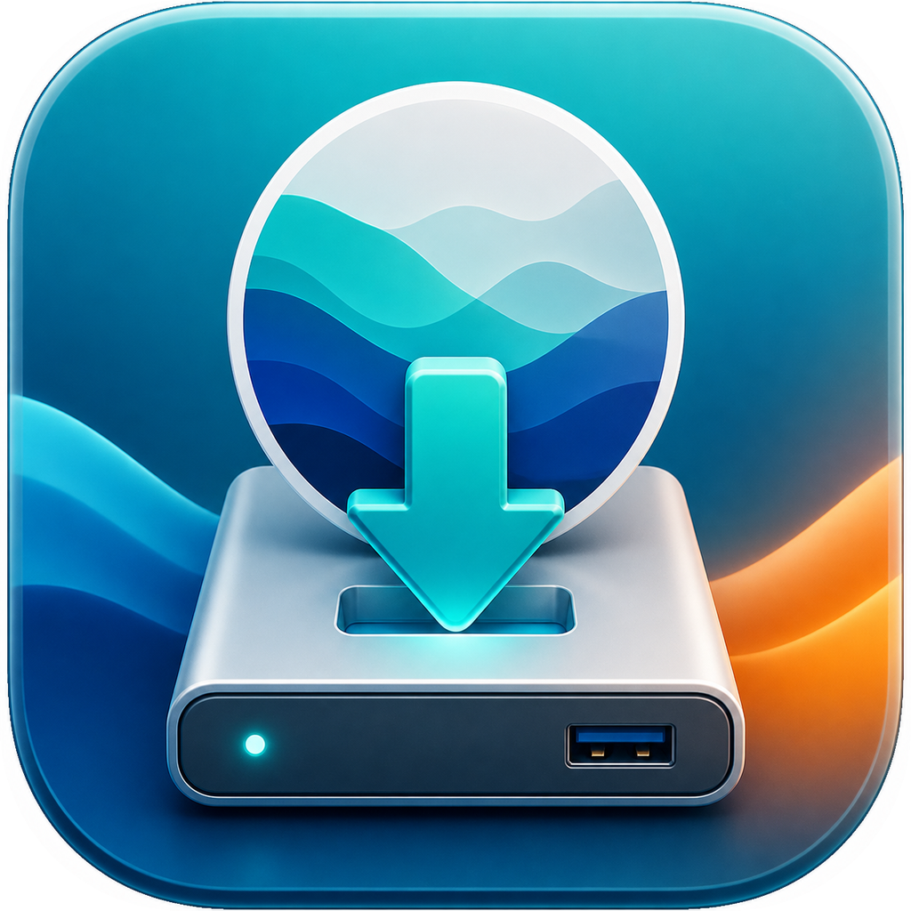

<p align="center">
  
</p>
<h1 align="center">macOS 下载器</h1>
<p align="center"><strong>下载 Apple 提供的 macOS 安装器，并制作可引导 U 盘。</strong><br>为 Apple Silicon Mac 打造的原生下载与写盘工具。</p>
<p align="center">
  
  
  <a href="https://github.com/ProvenceJake/macos-downloader/releases/tag/v1.0.0-preview.1"></a>
</p>
<p align="center"><a href="README.md">English</a> · <strong>简体中文</strong></p>
<p align="center">
  <a href="https://github.com/ProvenceJake/macos-downloader/releases/download/v1.0.0-preview.1/MacOS-Downloader-v1.0.0-preview.1-arm64.dmg"><strong>下载 Apple Silicon 版</strong></a> ·
  <a href="https://github.com/ProvenceJake/macos-downloader/releases/tag/v1.0.0-preview.1">发行说明</a> ·
  <a href="#从源码构建">从源码构建</a> ·
  <a href="#写入-u-盘之前">写盘须知</a> ·
  <a href="https://github.com/ProvenceJake/macos-downloader/issues">反馈问题</a>
</p>

---

macOS 下载器在启动和手动刷新时读取 Apple 软件更新目录。下载应用中配置的较新 macOS 版本前，还会再次解析可用的完整 `InstallAssistant.pkg`。下载在前台进行，界面显示已下载大小、速度、剩余时间和进度。部分旧版系统也提供 Apple DMG 的直接下载链接。

> [!IMPORTANT]
> 这是独立项目，并非 Apple 官方产品。预览版 DMG 与本地构建的应用都使用临时签名，**未经公证**。制作可引导 U 盘会**抹掉选中的整只外接磁盘**，确认前务必核对目标。

## 下载

下载 [Apple Silicon 版 DMG](https://github.com/ProvenceJake/macos-downloader/releases/download/v1.0.0-preview.1/MacOS-Downloader-v1.0.0-preview.1-arm64.dmg)，并核对 [SHA-256 校验值](https://github.com/ProvenceJake/macos-downloader/releases/download/v1.0.0-preview.1/SHA256SUMS.txt)。打开 DMG 后将 **MacOS下载器.app** 拖到“应用程序”。映像中也附有中英文 README。由于应用未经公证，macOS 可能在首次打开时给出警告；不要为此关闭整个系统的安全保护，也可以选择从源码构建。

## 功能

| 安装器目录 | 可视化下载 | 可引导 U 盘 |
| --- | --- | --- |
| 列出应用中配置的较新 macOS 系列，解析可用的完整安装器，并提供部分旧版 DMG 链接。 | 在前台下载 `InstallAssistant.pkg`，显示实时进度和速度，完成后把安装器安装到 `/Applications`。 | 识别本地安装器和已挂载的外接磁盘，调用 Apple 的 `createinstallmedia`，并在应用中显示命令输出。 |

安装器是否可获取取决于 Apple 目录和当前 Mac。目录里出现某个版本，**不代表**这台 Mac 一定能够安装它。下载或制作启动盘前，请查看 [Apple 的 macOS 兼容性说明](https://support.apple.com/zh-cn/102662)。

旧版 DMG 仅负责下载：打开 DMG 并运行其中的 PKG，把安装器放入 `/Applications`，然后回到应用刷新。仍需使用与该版本兼容的 Mac。

## 从源码构建

需要运行 macOS 14 或更高版本的 Apple Silicon Mac，以及带 Swift 的 Xcode 或 Xcode 命令行工具。

```sh
git clone https://github.com/ProvenceJake/macos-downloader.git
cd macos-downloader
./Scripts/build-arm64-app.sh
```

脚本会在 `build/MacOS下载器.app` 生成经过临时签名的 arm64 应用。将它移到 `/Applications` 后即可从启动台打开。应用界面目前主要使用中文；仓库提供中英文说明。

若要在本机制作与预览版布局相同的 DMG，可运行 `./Scripts/package-dmg.sh v1.0.0-preview.1`。映像和校验文件会写入已忽略的 `dist/` 目录。

## 写入 U 盘之前

1. 下载完整的 macOS 安装器，并确认安装器应用位于 `/Applications`。
2. 插入外接 U 盘，选择安装器和目标磁盘，仔细阅读抹盘确认。**目标磁盘上的全部数据都会被删除。**
3. 应用会打开“终端”运行 Apple 的 `createinstallmedia`。在终端输入管理员密码；如果 macOS 请求授权，请允许“终端”访问移动磁盘。命令完成前不要关闭该终端窗口。

如果目标是 APFS，应用会先将其格式化为 Mac OS Extended (Journaled)，因为 `createinstallmedia` 不能把 APFS 用作可引导安装介质。界面会显示格式化与写入进度，但最终应以安装器命令成功结束为准；请勿提前拔出 U 盘。

## 验证范围

项目包含目录解析、命令退出码和进度日志处理的冒烟测试。本地构建和这些测试不能证明所有 macOS 安装器、Mac 机型及 U 盘都已验证。应用不会安装后台下载服务，也不会自动定时写盘。

[反馈问题](https://github.com/ProvenceJake/macos-downloader/issues)时，请提供 macOS 版本、Mac 架构、安装器版本、目标磁盘格式和相关报错。公开日志前请移除序列号、私人路径和凭据。
